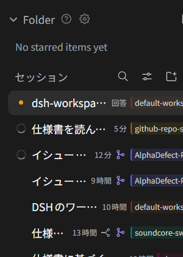

# dsh-workspace-project-labels

Shows each session's **project name** on its sidebar row in the DeepSeek Harness
Web GUI, with a stable color per project.

The sidebar's **In one list** view flattens every session into one list. Without
a Workspace heading above them, rows tell you the session title but not which
project the work belongs to. This plugin puts that back: a small colored chip on
each row.



Each chip carries the project's name and its own color, so a glance down the
list tells you which project each session belongs to. Hovering a chip shows the
full directory path.

## Install

```sh
dsh plugin --profile web add dsh-workspace-project-labels
```

Or install a local checkout:

```sh
dsh plugin --profile web add ./path/to/dsh-workspace-project-labels
```

Restart the Web UI after installing. The chip appears on every session row that
has a working directory matching a registered Workspace.

## What it shows

Each session row gets a chip carrying the title of the Workspace that owns the
session's working directory. Hovering the chip shows the full directory path.
The chip is clipped to keep the row's time label readable; the tooltip always
carries the complete name.

Sessions whose working directory matches no registered Workspace show no chip,
so the row stays as it was.

## Colors

Every project gets its own color. The color is derived from the project's
position in the creation-ordered Workspace list, using the golden angle so that
successive projects land far apart on the hue wheel, combined with twenty
lightness/saturation bands. Measured in CIE Lab, every pair of projects stays at
least ΔE 14 apart, so no two chips look alike.

- **The color survives a rename.** It follows the Workspace, not its title.
- **Adding a project does not recolor the others.** New projects append to the
  end of the order, so existing colors stay put.
- **Removing a project shifts later colors.** The order is positional, so a
  deletion moves every project after it one slot. This is the trade for
  guaranteeing distinct colors with no collisions.

The hue range skips the red band, which would read as an error state. The tint
is low-opacity and the text keeps the host's own color, so the chip stays
readable in both light and dark themes.

## How the Workspace is chosen

The plugin compares the session's working directory against every registered
Workspace path and picks the longest match. A session running in a nested
Workspace therefore shows the nested project, not its ancestor.

Paths are compared case-insensitively, matching how Windows treats them.

## Remote access

The plugin is a client-side module served from the same origin as the rest of
the Web UI, so it renders identically when you reach the GUI through a tunnel,
a reverse proxy, or a VPN such as Tailscale. Nothing is bound to `localhost`.

## Limitations

- The chip reads the session's stored working directory. A session whose
  directory was never recorded shows no chip.
- The label is the Workspace title. Renaming a Workspace updates every chip that
  points at it.
- The chip is display-only; it does not switch Workspace or open a menu.
- The chip renders in every grouping mode. In the grouped views the Workspace
  heading already names the project, so the chip is redundant there.

## Uninstall

```sh
dsh plugin --profile web remove dsh-workspace-project-labels
```

## License

MIT
