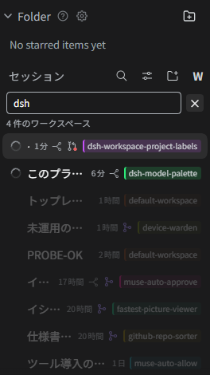

# Project labels in the session list

The sidebar's **In one list** view shows every session as one flat row. Without
a Workspace heading above them, a row tells you the session title but not which
project it belongs to. This plugin adds that missing piece: a small colored chip
on each row carrying the project's name.

Each chip carries the project's name and its own color, so a glance down the
list tells you which project each session belongs to. Hovering a chip shows the
full directory path.

## What it shows

Each session row gets a chip with the title of the Workspace that owns the
session's working directory. Hovering the chip shows the full directory path.

The chip takes whatever width the row leaves after its title and time label, so
a long project name stays readable instead of being cut at a fixed width. Only
when the sidebar itself is too narrow does the name clip, and the tooltip always
carries the complete name.

Sessions whose working directory matches no registered Workspace show no chip,
so the row stays as it was.

## Colors

Every project gets its own color, derived from its position in the
creation-ordered Workspace list. The golden angle spreads successive projects
far apart on the hue wheel, and twenty lightness/saturation bands add a second
axis. Measured in CIE Lab, every pair of projects stays at least ΔE 14 apart, so
no two chips look alike.

The color survives a rename because it follows the Workspace, not its title.
Adding a project appends to the end of the order and leaves existing colors
untouched; removing one shifts the colors of every project after it.

The hue range skips the red band, which would read as an error state. The tint
is low-opacity and the text keeps the host's own color, so the chip stays
readable in both light and dark themes.

## How the Workspace is chosen

The plugin compares the session's working directory against every registered
Workspace path and picks the longest match. A session running in a nested
Workspace therefore shows the nested project, not its ancestor.

Paths are compared case-insensitively, matching how Windows treats them.

## Where it appears

The chip is contributed to the session row's trailing seat, which the sidebar
renders in every grouping mode. It is most useful in **In one list**, where no
Workspace heading supplies the context, and it stays out of the way in the
grouped views because the heading already names the project.

## Searching by Workspace name

A field above the session list filters by **Workspace name**. It matches the
registered title case-insensitively and ignores session titles and conversation
content, so typing `github` finds the `github-bulk-cloner` and
`github-repo-sorter` Workspaces rather than every session that mentions GitHub.

While a query is active the field reports how many Workspaces match, and the
Workspaces that do not match are dimmed along with their sessions. Workspaces
with no sessions still count as matches, because the filter reads the registry
rather than the session list. **Esc** or **×** clears it.

Typing `dsh`: the two sessions that belong to matching Workspaces stay bright,
the field reports `4件のワークスペース`, and the rest of the list is dimmed.

The list keeps its layout while filtering. The host owns the row list and
exposes no filter hook, so non-matching rows are dimmed rather than removed;
selection, scrolling, and paging keep working, and clearing the query restores
the list instantly. Membership comes from the Workspace registry's own
`sessionIds`, so nothing is re-fetched and no history is loaded.

## Remote access

The plugin is a client-side module served from the same origin as the rest of
the Web UI, so it renders identically when you reach the GUI through a tunnel,
a reverse proxy, or a VPN such as Tailscale. Nothing is bound to `localhost`.

## Limitations

- The chip reads the session's stored working directory. A session whose
  directory was never recorded shows no chip.
- The label is the Workspace title. Renaming a Workspace updates every chip that
  points at it.
- The chip is display-only; it does not switch Workspace or open a menu.
- The search field dims rows; it does not remove them. A true filtered list
  needs a filter hook from the host, which DSH does not expose.
- Sessions that belong to no Workspace are dimmed whenever a query is active,
  because they have no Workspace name to match.
- The field is inserted into the sidebar's browsing region, which the host marks
  with `data-sidebar-list-area`. A DSH release that renames that attribute would
  hide the field until the plugin is updated.
